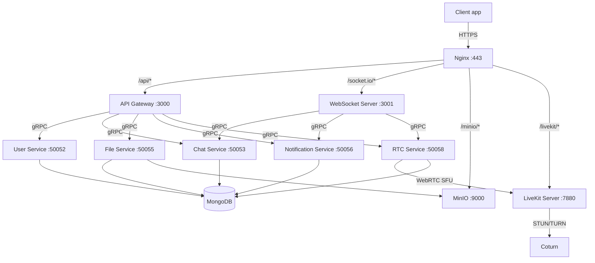

# NestJS IM microservices

[繁體中文](README.zh-TW.md)

Backend for an instant messaging app, split into seven NestJS services that talk to each other over gRPC.
It handles accounts, one-to-one and group chat over WebSocket, file attachments stored in MinIO, voice and
video calls through LiveKit, and push notifications to iOS (APNs) and Android (FCM). The whole stack starts
with one Docker Compose command.

## How a message travels

A client logs in through the API Gateway and gets a JWT. Before opening a WebSocket it exchanges the JWT for a
short-lived `ws_ticket` (30 seconds), so the long-lived token never appears in a WebSocket URL. After the
WebSocket server accepts the ticket, the client joins a room per conversation, and each message it sends is
forwarded to chat-service over gRPC. chat-service stores it in MongoDB and returns it; the WebSocket server broadcasts it to
the room and asks notification-service to push it to members who are offline.

Attachments do not pass through the services. file-service hands the client a pre-signed MinIO URL, the
client uploads directly to MinIO, and then confirms the upload so the file can be attached to a message.

## Architecture



## Services

| Service | Port | Responsibility |
|---|---|---|
| `api-gateway` | 3000 | REST entry point; verifies JWTs and forwards to the gRPC services |
| `websocket-server` | 3001 | Socket.IO connections: messages, typing indicators, read receipts, call signaling |
| `user-service` | 50052 | Registration, login, user lookup (bcrypt, JWT) |
| `chat-service` | 50053 | Conversations, members, message history, read state |
| `file-service` | 50055 | Pre-signed upload and download through MinIO |
| `notification-service` | 50056 | Push notifications through FCM and APNs |
| `rtc-service` | 50058 | Voice and video call sessions and LiveKit tokens |

Shared protobuf definitions are in [`services/protos`](services/protos). MongoDB runs as a replica set so
chat-service can use transactions.

## Tech stack

| Area | Technology |
|---|---|
| Framework | NestJS 11, TypeScript |
| Service-to-service | gRPC, Protocol Buffers |
| Real time | Socket.IO |
| Calls | LiveKit (WebRTC SFU), Coturn (STUN/TURN) |
| Database | MongoDB 8 replica set |
| Object storage | MinIO |
| Push | Firebase Cloud Messaging, Apple Push Notification service |
| Deployment | Docker Compose, Nginx |

## Running it

Requires Docker with Compose v2.

```bash
git clone https://github.com/dses1207/nestjs-realtime-messaging.git
cd nestjs-realtime-messaging

# change the *_EXTERNAL_PORT values here if a port is already in use
cp env.dev.example .env.dev

docker compose --env-file .env.dev -f docker-compose.dev.yml up -d --build
# or start the services in phases with progress output
./build.sh dev
```

The MongoDB replica-set keyfile is generated inside the container on first start. For a multi-node replica
set, run `scripts/generate-mongodb-keyfile.sh` once so every member mounts the same `keys/mongodb-keyfile`.

Push notifications need Firebase and APNs credentials. Without them notification-service still starts, logs
that push is disabled, and everything else works.

The API Gateway listens on `http://localhost:3050`:

```bash
# register
curl -X POST http://localhost:3050/auth/register \
  -H "Content-Type: application/json" \
  -d '{"email": "alice@example.com", "username": "alice", "password": "password123", "name": "Alice Chen"}'

# log in and get a JWT
curl -X POST http://localhost:3050/auth/login \
  -H "Content-Type: application/json" \
  -d '{"email": "alice@example.com", "password": "password123"}'

# check the token
curl http://localhost:3050/auth/validate -H "Authorization: Bearer <token>"
```

Useful commands:

```bash
docker compose --env-file .env.dev -f docker-compose.dev.yml ps
docker compose --env-file .env.dev -f docker-compose.dev.yml logs -f api-gateway
docker compose --env-file .env.dev -f docker-compose.dev.yml restart chat-service
docker compose --env-file .env.dev -f docker-compose.dev.yml down
```

## Repository layout

```
nestjs-realtime-messaging/
├── services/
│   ├── protos/                # shared gRPC definitions
│   ├── api-gateway/
│   ├── user-service/
│   ├── chat-service/
│   ├── file-service/
│   ├── notification-service/
│   ├── websocket-server/
│   └── rtc-service/
├── nginx/                     # example reverse proxy config
├── config/                    # LiveKit and Coturn config
├── scripts/
├── docs/                      # API reference and design documents
├── docker-compose.dev.yml
├── docker-compose.prod.yml
├── build.sh
└── env.dev.example
```

The documents under [`docs/`](docs/) (full API reference, WebSocket protocol, LiveKit and MinIO integration
designs) are written in Traditional Chinese.
