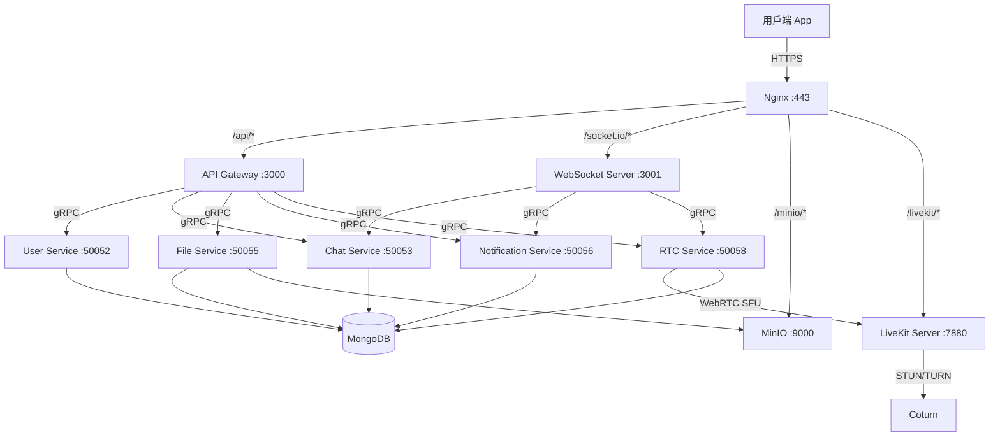

# NestJS IM microservices

[English](README.md)

即時通訊 App 的後端，拆成七個 NestJS 服務，服務之間用 gRPC 溝通。
功能包含帳號、透過 WebSocket 的一對一與群組聊天、存在 MinIO 的附件、透過 LiveKit 的語音與視訊通話，
以及 iOS（APNs）與 Android（FCM）推播。整套環境用一行 Docker Compose 指令就能啟動。

## 一則訊息怎麼送出去

用戶端先透過 API Gateway 登入拿到 JWT。開 WebSocket 之前，先用 JWT 換一張短效的 `ws_ticket`（30 秒），
這樣長效 token 就不會出現在 WebSocket 網址裡。WebSocket server 驗過 ticket 後，用戶端加入各個對話的房間，
送出的每則訊息再經由 gRPC 交給 chat-service。chat-service 寫進 MongoDB 後回傳，WebSocket server 廣播給房間內的成員，
並請 notification-service 推播給不在線上的成員。

附件不經過服務本身。file-service 發給用戶端一個 MinIO 預簽章網址，用戶端直接上傳到 MinIO，
再回報上傳完成，檔案就能附加到訊息上。

## 架構



## 服務

| 服務 | Port | 負責 |
|---|---|---|
| `api-gateway` | 3000 | REST 入口，驗證 JWT 後轉給各 gRPC 服務 |
| `websocket-server` | 3001 | Socket.IO 連線：訊息、輸入中提示、已讀回條、通話信令 |
| `user-service` | 50052 | 註冊、登入、查詢使用者（bcrypt、JWT） |
| `chat-service` | 50053 | 對話、成員、訊息紀錄、已讀狀態 |
| `file-service` | 50055 | 透過 MinIO 的預簽章上傳與下載 |
| `notification-service` | 50056 | 透過 FCM 與 APNs 推播 |
| `rtc-service` | 50058 | 語音與視訊通話的 session 與 LiveKit token |

共用的 protobuf 定義在 [`services/protos`](services/protos)。MongoDB 以 replica set 模式執行，
chat-service 才能使用 transaction。

## 技術棧

| 項目 | 技術 |
|---|---|
| 框架 | NestJS 11、TypeScript |
| 服務間通訊 | gRPC、Protocol Buffers |
| 即時通訊 | Socket.IO |
| 通話 | LiveKit（WebRTC SFU）、Coturn（STUN/TURN） |
| 資料庫 | MongoDB 8 replica set |
| 物件儲存 | MinIO |
| 推播 | Firebase Cloud Messaging、Apple Push Notification service |
| 部署 | Docker Compose、Nginx |

## 執行

需要 Docker 與 Compose v2。

```bash
git clone https://github.com/dses1207/nestjs-realtime-messaging.git
cd nestjs-realtime-messaging

# port 被占用時，改這裡的 *_EXTERNAL_PORT
cp env.dev.example .env.dev

docker compose --env-file .env.dev -f docker-compose.dev.yml up -d --build
# 或分階段啟動並顯示進度
./build.sh dev
```

MongoDB replica set 的 keyfile 會在容器第一次啟動時自動產生。要跑多節點 replica set 的話，
先執行一次 `scripts/generate-mongodb-keyfile.sh`，讓每個成員掛載同一份 `keys/mongodb-keyfile`。

推播需要 Firebase 與 APNs 的憑證。沒有憑證時 notification-service 一樣會啟動，只會在 log 註明推播已停用，
其他功能都正常。

API Gateway 位址是 `http://localhost:3050`：

```bash
# 註冊
curl -X POST http://localhost:3050/auth/register \
  -H "Content-Type: application/json" \
  -d '{"email": "alice@example.com", "username": "alice", "password": "password123", "name": "Alice Chen"}'

# 登入並取得 JWT
curl -X POST http://localhost:3050/auth/login \
  -H "Content-Type: application/json" \
  -d '{"email": "alice@example.com", "password": "password123"}'

# 檢查 token
curl http://localhost:3050/auth/validate -H "Authorization: Bearer <token>"
```

常用指令：

```bash
docker compose --env-file .env.dev -f docker-compose.dev.yml ps
docker compose --env-file .env.dev -f docker-compose.dev.yml logs -f api-gateway
docker compose --env-file .env.dev -f docker-compose.dev.yml restart chat-service
docker compose --env-file .env.dev -f docker-compose.dev.yml down
```

## Repo 結構

```
nestjs-realtime-messaging/
├── services/
│   ├── protos/                # 共用的 gRPC 定義
│   ├── api-gateway/
│   ├── user-service/
│   ├── chat-service/
│   ├── file-service/
│   ├── notification-service/
│   ├── websocket-server/
│   └── rtc-service/
├── nginx/                     # 反向代理設定範例
├── config/                    # LiveKit 與 Coturn 設定
├── scripts/
├── docs/                      # API 文件與設計文件
├── docker-compose.dev.yml
├── docker-compose.prod.yml
├── build.sh
└── env.dev.example
```

[`docs/`](docs/) 底下的文件（完整 API 文件、WebSocket 協定、LiveKit 與 MinIO 整合設計）目前只有中文版。
